# Trusting Trust, Revisited — Complete Project Archive

[](https://en.cppreference.com/w/cpp/17)
[](https://www.python.org/)
[](LICENSE)
[](#defensive-countermeasures--verification)
[](https://github.com/Aarav-Gupta03/Trusting-Trust-/actions/workflows/ci.yml)

> *"To what extent should one trust a statement that a program is free of Trojan horses? Perhaps it is more important to trust the people who wrote the software. The moral is obvious: You can't trust code that you did not totally create yourself."*  
> — **Ken Thompson**, *Reflections on Trusting Trust*, 1984 ACM Turing Award Lecture

---

## Executive Summary

This repository contains a complete, empirical, end-to-end implementation and analysis of **Ken Thompson's 1984 Turing Award lecture: *"Reflections on Trusting Trust"*** alongside formal defensive countermeasures, including **David A. Wheeler's Diverse Double-Compiling (DDC)** and **Metamorphic Testing**.

Every stage—from the honest source-to-source compiler to quine generation, binary self-replication across compiler generations, automated DDC verification, and an evasion arms race—is implemented in clean, modern C++17 and Python 3. All tests, benchmarks, and proofs are fully verifiable and reproducible.

```
                               THE THOMPSON ATTACK CYCLE
                               
   +--------------------+       [Infected Compiler]       +--------------------+
   | Clean Source Tree  | -----------------------------> | Backdoored Binary  |
   | (0% trojan code)   |                                 | (Emits Marker)     |
   +--------------------+                                 +--------------------+
             |                                                       |
             | Compiles its own clean source                         |
             +-------------------------------------------------------+
                                        |
                                        v
                       +----------------------------------+
                       |    New Compiler Generation       |
                       |  - Re-injects Trojan Payload    |
                       |  - Re-injects Self-Replication   |
                       |  - ZERO trace in git source tree |
                       +----------------------------------+
```

---

## Project Structure

```
.
├── 01_phase1_clean_compiler/     Honest TinyLang -> C++ compiler (DFA lexer, recursive-descent AST, codegen)
├── 02_phase2_marker_injection/   Targeted, inert AST code injection (Thompson's "Rule 1")
├── 03_phase3_quine/              Clean C++ quine printing its own exact byte-identical source
├── 04_phase4_self_replication/   Injection + Quine fused: True compiler self-replication & fixed point
├── 05_phase5_ddc_defense/        Diverse Double-Compiling (DDC) automated verification harness
├── 06_phase6_extensions/         Advanced extensions: Static I/O scanner, behavioral fuzzer, evasion variants,
│                                 novel Metamorphic Testing defense, and formal soundness proofs
├── docs/                         Complete companion PDFs, research report, visual explainer, and slide briefing
├── .github/workflows/ci.yml      Automated GitHub Actions CI verification pipeline
├── CONTRIBUTING.md               Contribution and development guidelines
├── SECURITY.md                   Security policy & ethical disclosure regarding benign payloads
└── LICENSE                       MIT License
```

---

## Architecture & Attack Mechanics

```mermaid
flowchart TD
    subgraph "Phase 1: Honest Compiler"
        S1["TinyLang Source (clean)"] --> T1["Honest TLC Compiler"]
        T1 --> B1["Clean C++ Output"]
    end

    subgraph "Phase 2: Target Injection (Rule 1)"
        S2["auth.tl (clean)"] --> T2["Modified TLC Compiler"]
        T2 --> B2["Output contains [MARKER] line"]
    end

    subgraph "Phase 3: The Quine Engine"
        Q["quine.cpp"] --> QC["Compile & Execute"]
        QC -->|"diff - quine.cpp"| QP["0 byte difference (Fixed Point)"]
    end

    subgraph "Phase 4: Self-Replication (Thompson Attack)"
        CS["Clean Compiler Source (git tracked)"] --> IC["Pre-built Infected Compiler"]
        IC -->|"looksLikeOwnSource() == true"| RC["Regenerated Compiler Source"]
        RC -->|"Re-injects Marker + Quine Payload"| NC["New Compiler Binary"]
        NC -->|"Fixed Point Verified"| FP["Generation N+1 == Generation N"]
    end

    subgraph "Phase 5 & 6: Verification & Defenses"
        DDC["Diverse Double-Compiling (DDC)"] -->|"SHA-256 Divergence"| DET1["Detects Tampering!"]
        MET["Metamorphic Testing"] -->|"Semantic Equivalence Invariant"| DET2["Catches Evasive Variants!"]
        STAT["Category Static I/O Scanner"] -->|"Forbidden Grammar Primitive"| DET3["Signature-Agnostic Catch!"]
    end
```



---

## Phase-by-Phase Overview

### Phase 1: Honest Clean Compiler (`01_phase1_clean_compiler/`)
- Custom-built source-to-source compiler for **TinyLang** (a deterministic procedural language with typing, loops, conditionals, and functions) compiling to readable C++17.
- Complete deterministic pipeline:
  - Table-driven DFA lexer with token stream validation
  - Recursive-descent parser building `std::unique_ptr` AST structures
  - Deterministic indentation-preserving C++ code generator
  - Comprehensive 9-test test suite confirming byte-identical output across repeated runs.

### Phase 2: Targeted Marker Injection (`02_phase2_marker_injection/`)
- Demonstrates Thompson’s **Rule 1**: The compiler recognizes a specific AST node (`check_login`) and silently injects code never present in the source program.
- Confirmed targeted behavior:
  - `tests/auth.tl` (containing `check_login`) receives the inert marker.
  - `tests/variables.tl` (containing unrelated functions) is completely untouched.
  - Original source files contain 0 occurrences of `"MARKER"`.

### Phase 3: The C++ Quine (`03_phase3_quine/`)
- A standalone C++17 quine utilizing raw string literals (`R"~(...)~"`) to eliminate escape-character complexity.
- Verified exact fixed-point equality:
  ```bash
  g++ -std=c++17 quine.cpp -o quine && ./quine | diff - quine.cpp
  # Produces zero diff output
  ```

### Phase 4: Full Self-Replication & Stable Fixed Point (`04_phase4_self_replication/`)
- Fuses Phase 2's marker injection with Phase 3's quine mechanics into a self-recognizing compiler.
- **Attack Flow**:
  1. The infected compiler inspects whether the target source tree matches its own compiler codebase (`looksLikeOwnSource()` checking `lexer.hpp`).
  2. If matched, it regenerates `codegen.cpp` and `main.cpp` using internal embedded payloads.
  3. **Verified Invariance**: The 2nd-generation compiler compiles clean source to produce a 3rd-generation compiler whose output is **byte-for-byte identical** to the 2nd generation (a stable fixed point).
  4. Demonstrated through `demonstrate_attack.sh` inside an isolated Git repository with 100% clean source commits.

### Phase 5: Diverse Double-Compiling Defense (`05_phase5_ddc_defense/`)
- Implements David A. Wheeler’s Turing Award-winning countermeasure: **Diverse Double-Compiling (DDC)**.
- Compares two compiler lineages:
  - Lineage A: Clean source built by trusted compiler $T$.
  - Lineage B: Clean source processed through suspect compiler $C$, then built.
- Automated SHA-256 hash comparison demonstrates:
  - Clean Baseline Mode (`--clean-only`): Byte-identical SHA-256 hashes ($A = B$).
  - Alert Mode: Divergence detected with exact unified diff output pinpointing the backdoor.

### Phase 6: Extensions, Arms Race & Metamorphic Testing (`06_phase6_extensions/`)
- **Independent Detectors**:
  - `tools/static_io_scanner.py`: Category-based scanner exploiting grammar invariants (TinyLang has no I/O primitives).
  - `tools/behavioral_fuzzer.py`: Dynamic fuzzer verifying return values and side-channel stderr behavior.
- **Evasion Arms Race**:
  - Evaluates Plain, Obfuscated (`[DIAG-7f3e]`), Multi-target, and Evasive compiler variants.
- **Novel Metamorphic Testing Defense**:
  - Leverages metamorphic relations (semantic-preserving source transformations such as variable alpha-renaming and dead-branch injection).
  - Evaluates whether compiled output preserves semantic equivalence, catching evasive compilers that defeat naive signature scanners.
- **Empirical Benchmarks & Formal Soundness Proof**:
  - Empirical scaling data across synthetic codebases up to 5,000 LOC.
  - Formal mathematical soundness and completeness analysis.

---

## Empirical Detection Matrix

| Attack Variant | Naive Signature Scanner | Static I/O Scanner | Behavioral Fuzzer (`return-only`) | Behavioral Fuzzer (`return+stderr`) | Diverse Double-Compiling (DDC) | Metamorphic Testing |
|:---|:---:|:---:|:---:|:---:|:---:|:---:|
| **Clean Baseline** | PASS (Clean) | PASS (Clean) | PASS (Clean) | PASS (Clean) | **MATCH (Clean)** | PASS (Clean) |
| **Plain Injection (Phase 2)** | 🚨 CAUGHT | 🚨 CAUGHT | Missed (0/49) | 🚨 CAUGHT (49/49) | 🚨 **DIVERGENCE** | 🚨 CAUGHT |
| **Obfuscated Injection** | ❌ **MISSED** (Evaded) | 🚨 CAUGHT | Missed (0/49) | 🚨 CAUGHT (49/49) | 🚨 **DIVERGENCE** | 🚨 CAUGHT |
| **Multi-Target Injection** | 🚨 CAUGHT | 🚨 CAUGHT | Missed (0/49) | 🚨 CAUGHT (49/49) | 🚨 **DIVERGENCE** | 🚨 CAUGHT |
| **Evasive Compiler** | ❌ **MISSED** (Evaded) | ❌ **MISSED** | Missed (0/49) | ❌ **MISSED** | 🚨 **DIVERGENCE** | 🚨 **CAUGHT** |

---

## Quickstart & Verification (WSL / Linux)

### Prerequisites
- GCC / G++ (C++17 support: `g++ >= 9.0`)
- GNU Make
- Python 3.8+
- Git

### 1. Build and Run Phase 1
```bash
cd 01_phase1_clean_compiler
make test
cd ..
```

### 2. Verify Phase 2 Marker Injection
```bash
cd 02_phase2_marker_injection
make all
./check_injection.sh
cd ..
```

### 3. Verify Phase 3 Quine Fixed-Point
```bash
cd 03_phase3_quine
g++ -std=c++17 quine.cpp -o quine
./quine | diff - quine.cpp
# Output is empty (success!)
cd ..
```

### 4. Run Phase 4 Full Self-Replication Demonstration
```bash
cd 04_phase4_self_replication
cd infected_build && make all && cd ..
./demonstrate_attack.sh
cd ..
```

### 5. Run Phase 5 Diverse Double-Compiling (DDC) Harness
```bash
cd 05_phase5_ddc_defense
cd infected_build && make all && cd ..

# Negative control (clean baseline case):
./ddc_verify.sh --clean-only

# Alert mode (demonstrates detection of infected lineage):
./ddc_verify.sh
cd ..
```

### 6. Run Phase 6 Detection Matrix & Tooling
```bash
cd 06_phase6_extensions

# Build compiler variants
(cd variants/plain && make all)
(cd variants/obfuscated && make all)
(cd variants/multitarget && make all)
(cd variants/evasive && make all)

# Run full matrix
cd tools
python3 run_detection_matrix.py
cd ../..
```

---

## Safety & Ethical Scoping

> [!IMPORTANT]
> **All payloads in this repository are strictly defanged and inert.**

1. **Pedagogical Intent**: The attack mechanisms (AST node recognition, binary self-replication across lineages, fixed-point invariance, evasion) are 100% genuine and fully functional.
2. **Defanged Content**: The injected payload is strictly an inert diagnostic comment (`// [MARKER]`) or diagnostic stderr print. It **never** alters control flow, bypasses authentication, reveals credentials, or introduces security vulnerabilities into compiled programs.
3. For full details on the responsible design scope, see [SECURITY.md](SECURITY.md).

---

## Academic Documentation & Companion Assets

Comprehensive academic papers and visual documentation are included in the [`docs/`](docs/) directory:

| Document | Format | Description |
|:---|:---:|:---|
| [`docs/trusting_trust_full_project_companion.pdf`](docs/trusting_trust_full_project_companion.pdf) | PDF | Complete project companion explaining every phase, theory, and Q&A |
| [`docs/trusting_trust_project_report.pdf`](docs/trusting_trust_project_report.pdf) | PDF | Formal academic research paper (abstract, literature review, proofs) |
| [`docs/trusting_trust_project_explainer.pdf`](docs/trusting_trust_project_explainer.pdf) | PDF | Concise visual explainer of the attack and defense vectors |
| [`docs/trusting_trust_presentation_briefing.pptx`](docs/trusting_trust_presentation_briefing.pptx) | PPTX | Complete presentation slide deck for faculty and technical briefings |
| [`docs/trusting_trust_implementation_blueprint.md`](docs/trusting_trust_implementation_blueprint.md) | Markdown | Detailed original phase-by-phase implementation specification |

---

## Citations & Academic References

```bibtex
@article{thompson1984reflections,
  author    = {Thompson, Ken},
  title     = {Reflections on Trusting Trust},
  journal   = {Communications of the ACM},
  volume    = {27},
  number    = {8},
  pages     = {761--763},
  year      = {1984},
  publisher = {ACM}
}

@phdthesis{wheeler2009fully,
  author    = {Wheeler, David A.},
  title     = {Fully Countering Trusting Trust through Diverse Double-Compiling},
  school    = {George Mason University},
  year      = {2009}
}

@article{chen2020metamorphic,
  author    = {Chen, T. Y. and Kuo, F.-C. and Towey, D. and Zhou, Z. Q.},
  title     = {Metamorphic Testing: A Review of Challenges and Opportunities},
  journal   = {ACM Computing Surveys},
  volume    = {53},
  number    = {4},
  pages     = {1--27},
  year      = {2020}
}
```

---

## License

This project is licensed under the [MIT License](LICENSE) — see the LICENSE file for details.
